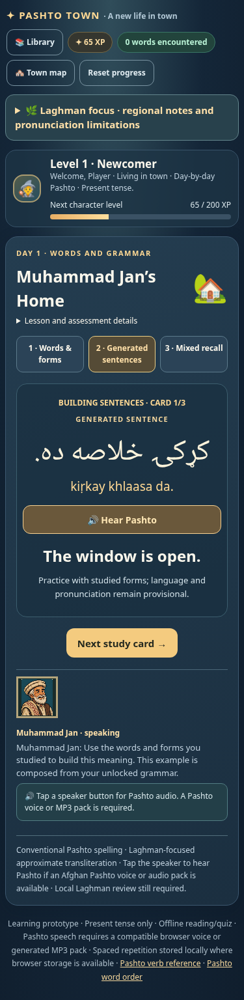
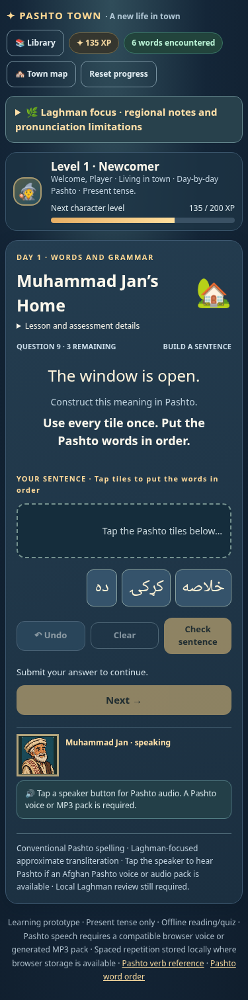

# Measured instructional sentence delivery

**6275 / 6275 independently observed sentence surfaces were generated: 100%.** Zero authored curricular sentence surfaces were delivered. The two separately approved onboarding questions are outside this curricular denominator. The 18 designated fixed expressions are excluded from this denominator; profiles that delivered no sentences are marked N/A rather than assigned a fictitious percentage.

Actual rendered browser surfaces across ten complete profiles; compiler provenance and actual form/grammar unlocks checked independently at each sentence surface.

Test-only educational navigation harness: fourteen-day shared-engine regression matrix. The default release is a Days 1–7 RPG, verified separately by the public normal/skip routes in rpg-week1-browser.test.mjs and movement/interface checks at 375/1280px.

Release SHA-256: `ea87b9eb4ceebaaa220fd0a8d8a1985a0bdfc91a922fe12d41de3d97dd89fcb2`. The complete browser matrix covered 280 normal district visits and 70 School visits on shortcut routes and 140 assessments, all fourteen days, five paces and normal/skip paths. Observer assertions compare rendered text and compiler reconstruction and check actual introduced forms and grammar.

## Day 1 Home: before and after

Before the original generated-delivery redesign, the default Home visit taught two stored cards, then displayed the same two texts again as generated cards: four sentence-study cards, two unique propositions. Grammar came before word study. The archived sources remain proof/fixtures, not runtime language content.

| Before: sentence-study order | Pashto | Source |
|---:|---|---|
| 1 | کور لوی دی. | Stored authored card s3-house |
| 2 | دروازه خلاصه ده. | Stored authored card s-it-door |
| 3–4 | Same two texts | Duplicate generated cards |

In the current release: Library onboarding is separate (two fixed greetings and two separately owner-approved authored questions). School first teaches Book/New and agreement. At Home, the player studies eight assigned district lemmas plus the required feminine adjective form, reviews agreement, then receives these engine-composed descriptions and practises them with shuffled indexed word tiles:

| Pashto | English | Origin |
|---|---|---|
| کور نوی دی. | The house is new. | productive engine |
| کتاب خلاص دی. | The book is open. | productive engine |
| دروازه خلاصه ده. | The door is open. | productive engine |

Default Home needs only the compulsory School lesson and introduces no action verb. The window/open pairing is composed from independently licensed noun and adjective features; the complete output is not an authored target. Supported paces are 8/12/16/20/24. If new words lack enough licensed combinations, practice also uses eligible cumulative vocabulary. If the complete licensed pool cannot supply a compatible clause, visits and assessments adapt with vocabulary/approved phrase tasks, without extra district lemmas or a fixed-sentence substitution.

## Actual generated assessment families by day, default pace

| Day | Generated question/answer families | Dialogue families | Adapted tasks |
|---|---|---|---:|
| 1 | equative_descriptor | None | 0 |
| 2 | present_attributive, present_transitive | None | 0 |
| 3 | present_attributive, present_transitive | None | 0 |
| 4 | coordinated_present, present_attributive, present_transitive | None | 0 |
| 5 | present_transitive | None | 0 |
| 6 | equative_descriptor, present_attributive | None | 0 |
| 7 | coordinated_present, present_joint_action, present_transitive | None | 0 |
| 8 | attributive_equative, demonstrative_descriptor, demonstrative_transitive, equative_noun, present_transitive | None | 0 |
| 9 | counted_equative, counted_transitive, demonstrative_transitive | None | 0 |
| 10 | attributive_equative, location_adverb_equative, spatial_equative, where_question | None | 0 |
| 11 | demonstrative_transitive, location_adverb_equative, possessive_descriptor, possessive_equative, possessive_spatial | None | 0 |
| 12 | demonstrative_descriptor, how_many_question, location_adverb_equative, possessive_equative, what_object_question, which_question, who_subject_question, whose_question | None | 0 |
| 13 | demonstrative_descriptor, location_adverb_equative, possessive_equative, present_intransitive_adverb, present_transitive_adverb | None | 0 |
| 14 | attributive_equative, count_location, counted_transitive, demonstrative_descriptor, how_many_question, location_adverb_equative, possessive_equative, present_attributive, present_compound_predicate, present_compound_transitive, present_joint_action, present_transitive, present_transitive_adverb, spatial_equative, what_object_question, who_subject_question | None | 0 |

## All tested profiles

| District pace | Route | Observed sentence surfaces | Generated |
|---:|---|---:|---:|
| 8 | Normal | 779 | 100% |
| 8 | Skip | 447 | 100% |
| 12 | Normal | 818 | 100% |
| 12 | Skip | 448 | 100% |
| 16 | Normal | 793 | 100% |
| 16 | Skip | 488 | 100% |
| 20 | Normal | 783 | 100% |
| 20 | Skip | 468 | 100% |
| 24 | Normal | 793 | 100% |
| 24 | Skip | 458 | 100% |

## Fixed expression inventory

| ID | Pashto | English |
|---|---|---|
| g-hello | سلام | Hello |
| g-how | څنګه یې؟ | How are you? |
| g-thanks | مننه | Thank you |
| g-bye | خدای پامان | Goodbye |
| phrase-d1-home-welcome | ښه راغلاست | Welcome! |
| phrase-day-2-opening | سهار مو پخیر! | Good morning! |
| phrase-day-3-opening | خوشحاله یم چې تاسې وینم. | It’s nice to see you |
| phrase-day-4-opening | ستړي مه شئ. | May you not be tired |
| phrase-day-5-opening | السلام علیکم. | Peace be upon you |
| phrase-day-6-opening | ستاسې په لیدو خوشحاله شوم. | Nice to meet you |
| phrase-day-7-opening | وعلیکم السلام. | And peace be upon you |
| phrase-day-8-opening | چېرته وئ؟ | Where have you been? |
| phrase-day-9-opening | مهرباني وکړئ، دننه راشئ. | Please, come in |
| phrase-day-10-opening | وبخښئ. | Excuse me |
| phrase-day-11-opening | دا خپل کور وګڼئ. | Make yourself at home |
| phrase-day-12-opening | اجازه شته چې یوه پوښتنه وکړم؟ | May I ask a question? |
| phrase-day-13-opening | ورځ مو څنګه تېرېږي؟ | How is your day going? |
| phrase-day-14-opening | بریالي اوسئ! | Good luck! |

No ordinary descriptions, actions, questions, possession or spatial sentences are phrase exceptions. Individual inflected words and licensed grammatical chunks are studied as forms; when used in a clause, they must pass the sentence compiler. The two authored onboarding questions are separately approved in content/TUTORIAL_PROMPTS.json and excluded from the curricular sentence denominator. Optional player profile settings are English interface controls.

## Architecture and limits

The standard curriculum contains no authored sentence cards, lesson sentence targets or fixed grammar models; only explicitly registered conventional expressions have fixed conversational responses. It builds no sentence catalogue before study or explicit challenge activation. Templates compile against the current introduced forms and actual grammar; typed dialogues join compatible generated questions and responses, presented as direct English construction targets. Challenge activation unlocks the frozen current-day location material before question generation, with honest provenance and no fabricated study grades. Current-day vocabulary is preferred alongside cumulative revision; active attempts remain frozen. Frozen attempts retain complete text/gloss, indices, choices, scene, speaker/recipient, source forms and ASTs. A generated label alone is insufficient: bodies are recomposed and checked. Standard visits exclude earlier studied sentence texts and require a noun/verb first introduced by that lesson when available; no compatible binding uses a bounded vocabulary/form fallback. Explicit revision/replay handles repetition and historical lesson pools.

[Capacity and exact missing forms/features](GENERATION_COVERAGE.md) are separate diagnostics. Unattested inflections, missing counted numeral constructions and unlicensed obliques remain excluded. Base entries and conventional expressions are user-approved; inflections, grammar and composed language remain provisional; automated consistency, Chromium/mobile layouts and mocked audio are not native Laghman review or physical iPhone/Windows testing.
