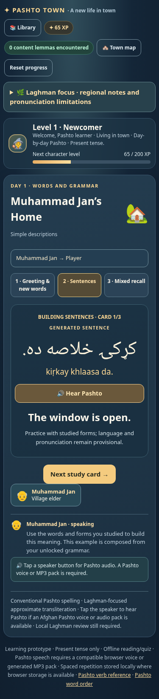
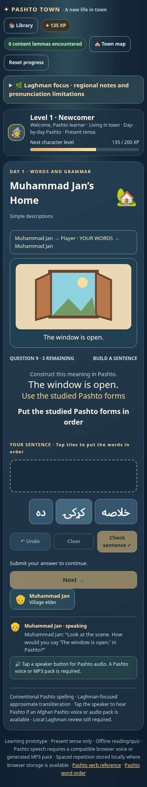

# Measured instructional sentence delivery

**4647 / 4647 independently observed sentence surfaces were generated: 100%.** Zero authored sentence surfaces were delivered. The 18 designated fixed expressions are excluded from this denominator; profiles that delivered no sentences are marked N/A rather than assigned a fictitious percentage.

Actual rendered browser surfaces across fourteen complete profiles; compiler provenance and actual form/grammar unlocks checked independently at each sentence surface.

Release SHA-256: `b02e9f3299a3d17dac6b948b7b7bece47638e05166cffab613980c7c9a048756`. The complete browser matrix covered 392 normal district visits and 196 assessments, all fourteen days, seven paces and normal/skip paths. Observer assertions compare rendered text and compiler reconstruction and check actual introduced forms and grammar.

## Day 1 Home: before and after

Before this revision, the default Home visit taught two stored cards, then displayed the same two texts again as generated cards: four sentence-study cards, two unique propositions. Grammar came before word study. The archived sources remain proof/fixtures, not runtime language content.

| Before: sentence-study order | Pashto | Source |
|---:|---|---|
| 1 | کور لوی دی. | Stored authored card s3-house |
| 2 | دروازه خلاصه ده. | Stored authored card s-it-door |
| 3–4 | Same two texts | Duplicate generated cards |

After this revision: Library onboarding is separate (two fixed greetings and two English profile settings). At Home, the player studies exactly six assigned district lemmas plus the required feminine adjective form, reads the agreement rule, then receives these engine-composed descriptions and practises them with shuffled indexed word tiles:

| Pashto | English | Origin |
|---|---|---|
| کړکۍ خلاصه ده. | The window is open. | productive engine |
| کور لوی دی. | The house is big. | productive engine |
| دروازه خلاصه ده. | The door is open. | productive engine |

Default Home needs no other district visit and introduces no action verb. The window/open pairing is composed from independently licensed noun and adjective features; the complete output is not an authored target. At paces 0 and 4, fewer than two compositions are available from the prescribed district words. Visits and assessments adapt with explicit word/English-grammar tasks, without extra district lemmas or a fixed-sentence substitution.

## Actual generated assessment families by day, default pace

| Day | Generated question/answer families | Dialogue families | Adapted tasks |
|---|---|---|---:|
| 1 | equative_descriptor | guided_scene | 0 |
| 2 | equative_descriptor, present_attributive, present_transitive | guided_scene | 0 |
| 3 | present_attributive, present_intransitive, present_transitive | guided_scene | 0 |
| 4 | coordinated_present, present_attributive, present_transitive | guided_scene | 0 |
| 5 | present_attributive, present_transitive | guided_scene | 0 |
| 6 | present_attributive, present_compound_predicate, present_joint_action, present_transitive | guided_scene | 0 |
| 7 | coordinated_present, present_attributive, present_compound_transitive, present_joint_action, present_transitive | guided_scene | 0 |
| 8 | attributive_equative, demonstrative_descriptor, demonstrative_transitive, equative_noun, present_transitive | guided_scene | 0 |
| 9 | counted_equative, counted_transitive, demonstrative_transitive | guided_scene | 0 |
| 10 | counted_transitive, demonstrative_transitive, location_adverb_equative, spatial_equative, where_question | guided_scene, where_question | 0 |
| 11 | location_adverb_equative, possessive_descriptor, possessive_equative, possessive_spatial, present_attributive, present_transitive | guided_scene, where_question | 0 |
| 12 | demonstrative_descriptor, how_many_question, location_adverb_equative, present_transitive, what_object_question, where_question, which_question, who_subject_question, whose_question | where_question, which_question, who_subject_question | 0 |
| 13 | count_location, demonstrative_transitive, present_intransitive_adverb, present_transitive, present_transitive_adverb | guided_scene, how_many_question, what_object_question | 0 |
| 14 | coordinated_present, count_location, demonstrative_descriptor, demonstrative_transitive, equative_descriptor, how_many_question, location_adverb_equative, possessive_equative, present_attributive, present_intransitive_adverb, present_transitive, spatial_equative, what_object_question, which_question | guided_scene, how_many_question, what_object_question, where_question, which_question, who_subject_question, whose_question | 0 |

## All tested profiles

| District pace | Route | Observed sentence surfaces | Generated |
|---:|---|---:|---:|
| 0 | Normal | 0 | N/A (no sentences) |
| 0 | Skip | 0 | N/A (no sentences) |
| 4 | Normal | 741 | 100% |
| 4 | Skip | 0 | N/A (no sentences) |
| 8 | Normal | 751 | 100% |
| 8 | Skip | 0 | N/A (no sentences) |
| 12 | Normal | 773 | 100% |
| 12 | Skip | 0 | N/A (no sentences) |
| 16 | Normal | 791 | 100% |
| 16 | Skip | 0 | N/A (no sentences) |
| 20 | Normal | 794 | 100% |
| 20 | Skip | 0 | N/A (no sentences) |
| 24 | Normal | 797 | 100% |
| 24 | Skip | 0 | N/A (no sentences) |

## Fixed expression inventory

| ID | Pashto | English |
|---|---|---|
| g-hello | سلام | Hello |
| g-how | څنګه یې؟ | How are you? |
| g-thanks | مننه | Thank you |
| g-bye | خدای پامان | Goodbye |
| phrase-d1-home-welcome | ښه راغلاست | Welcome! |
| phrase-day-2-opening | سهار مو پخیر! | Good morning! |
| phrase-day-3-opening | خوشحاله یم چې تاسې وینم. | It’s nice to see you |
| phrase-day-4-opening | ستړي مه شئ. | May you not be tired |
| phrase-day-5-opening | السلام علیکم. | Peace be upon you |
| phrase-day-6-opening | ستاسې په لیدو خوشحاله شوم. | Nice to meet you |
| phrase-day-7-opening | وعلیکم السلام. | And peace be upon you |
| phrase-day-8-opening | چېرته وئ؟ | Where have you been? |
| phrase-day-9-opening | مهرباني وکړئ، دننه راشئ. | Please, come in |
| phrase-day-10-opening | وبخښئ. | Excuse me |
| phrase-day-11-opening | دا خپل کور وګڼئ. | Make yourself at home |
| phrase-day-12-opening | اجازه شته چې یوه پوښتنه وکړم؟ | May I ask a question? |
| phrase-day-13-opening | ورځ مو څنګه تېرېږي؟ | How is your day going? |
| phrase-day-14-opening | بریالي اوسئ! | Good luck! |

No ordinary descriptions, actions, questions, possession or spatial sentences are phrase exceptions. Individual inflected words and licensed grammatical chunks are studied as forms; when used in a clause, they must pass the sentence compiler. Profile name/gender questions are English interface settings and are not Pashto exceptions.

## Architecture and limits

The runtime contains no authored sentence cards, lesson sentence targets or fixed grammar models; only explicitly registered conventional expressions have fixed conversational responses. It builds no sentence catalogue before study. Templates compile against the current introduced forms and actual grammar; typed dialogues join compatible generated questions and responses. Frozen attempts retain complete text/gloss, indices, choices, scene, speaker/recipient, source forms and ASTs. A generated label alone is insufficient: bodies are recomposed and checked. Standard visits exclude earlier studied sentence texts; explicit revision/replay handles repetition.

[Capacity and exact missing forms/features](GENERATION_COVERAGE.md) are separate diagnostics. Unattested inflections, missing counted numeral constructions and unlicensed obliques remain excluded. Base entries and conventional expressions are user-approved; inflections, grammar and composed language remain provisional; automated consistency, Chromium/mobile layouts and mocked audio are not native Laghman review or physical iPhone/Windows testing.
