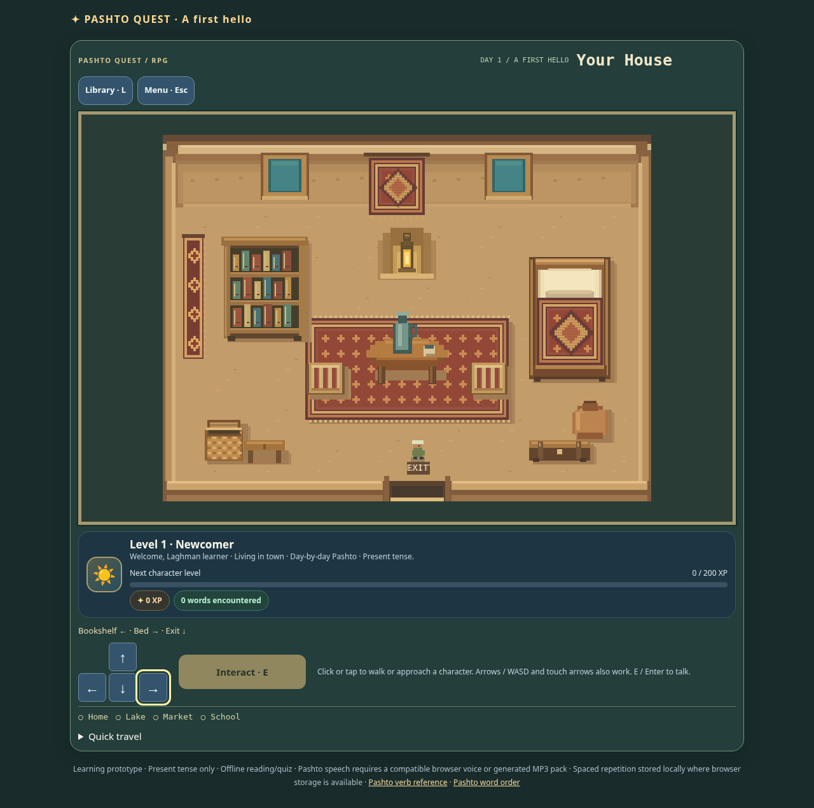
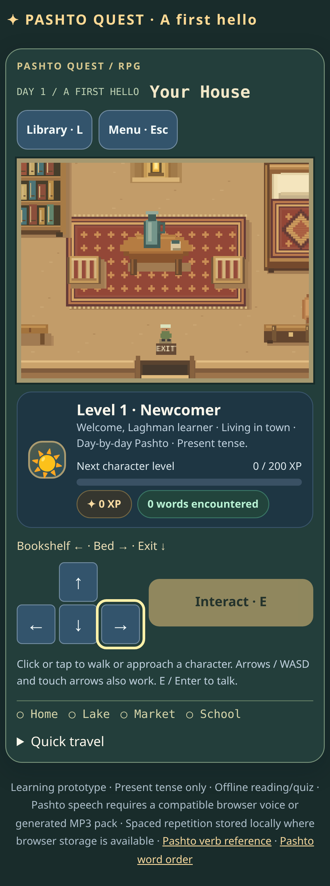
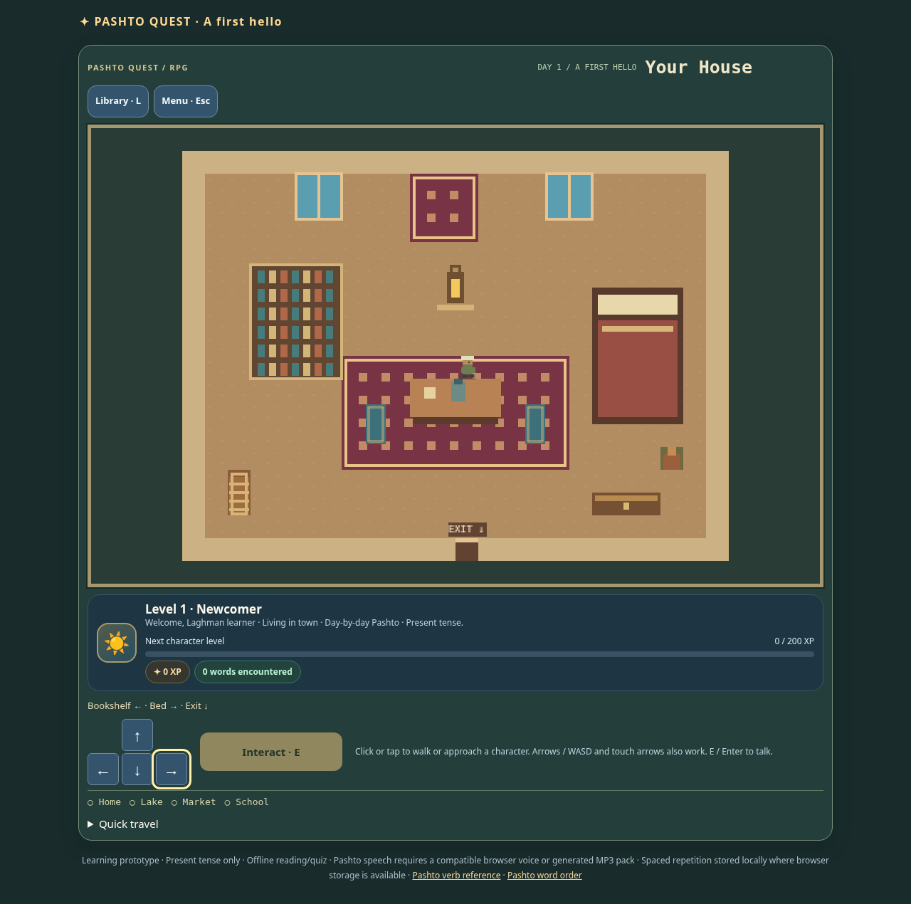

# House, sleep and dream package

This package builds on `feature/rpg-multiday-overhaul`. The latest base commits supplied the [approved interior reference](../design/house-interior-reference.png) during implementation; the room follows its bookshelf-left, bed-right, central rug/table/cushions, rear windows/textile/lantern and bottom-exit arrangement. Furniture is drawn as pixel art on the existing 16-pixel Phaser grid. UI text and controls remain live HTML.

## Implemented changes

1. The activity summary bar and illustrated English vocabulary/sentence preview boards are gone. Instructor, active speaker and conversation partner have separate identifiers. The shared dialogue area renders one approved portrait when roles coincide and a second when the partner differs. Portraits retain the existing Phaser-loaded assets and pixelated rendering.
2. Tutorial Cards 3/4 ask the two exact owner-approved Pashto questions in [TUTORIAL_PROMPTS.json](../../content/TUTORIAL_PROMPTS.json). Card 3 selects پښتو from Pashto language-name choices; Card 4 uses the existing English answer evaluator for Muhammad Jan, case/whitespace normalization and listed spelling variants. Player Profile moved to the shared Library and defaults to Player / Prefer not to say. Muhammad Jan’s reminder is informational and never gates progress.
3. Shared construction feedback presents the correct Pashto, the existing full-sentence romanisation and English after submission, with wrapping on narrow screens. No full romanisation is exposed while arranging tiles. Feedback, grading and success-only sentence audio remain shared.
4. Semantic preview rendering and its CSS were removed from all activity surfaces. Core word/form data, generated sentences, choices, grammar, audio and rewards remain in their existing authorities.
5. The house is a separate explorable map reached through the village house doorway. Bed opens Sleep/Dream; bookshelf opens the same Library as the toolbar. Both furniture footprints are full pointer/touch targets; the shared pathfinder approaches their accessible interaction tile. Both Library closing and dream exit preserve the indoor tile. The bottom door returns to the courtyard outside the entrance.

## Sleep and review state

| State | Authority / meaning |
|---|---|
| Active campaign day | World save `chapter`, resolved to the registered chapter; education access still requires real challenge records. |
| Challenge passed / completed days | Existing education `challenges[day].passed`. This is never inferred from XP. |
| Ready for sleep | Current day passed and its registered next chapter is available. The current chapter remains active until sleep. |
| Transition in progress | Synchronous `sleeping`/`advancing` guards plus durable world `sleepIntent: {from,to}`. |
| Dream availability | Registered days with a passed challenge; their four existing lesson IDs. |
| Dream activity | Temporary copy of education state with `reviewOnly`; canonical object retained in memory as `reviewCampaign`. |

Bed and Quick Travel invoke the same sleep function. It checks the challenge, validates the next registered day and durably records intent before transition. It then commits the next chapter/spawn and starts a quiet day with the existing schedules/access; the opening is available through its teacher. Repeated clicks cannot run concurrently. A reload with source chapter and intent resumes that exact transition; a reload with target chapter clears the marker. A paused challenge retry must be resumed before sleeping, so its retained snapshot cannot pull the player back to the previous chapter after reload. No further chapter shows a message without advancing. Day 7 remains the current available campaign boundary.

Passing a challenge shows “Day complete! Return home and sleep to begin the next day.” Go home travels into the house without changing the day, and the player may continue exploring. Ending dialogue still uses the established narrative lifecycle; sleep does not award any narrative or educational reward.

Dream selectors resemble Quick Travel. A lesson uses the normal study, grammar, generation, questions, scoring feedback and audio engine. All practice changes happen in a disposable copy: XP and lesson-completion reward functions return zero, challenges cannot start, and saves/exports keep the canonical campaign. Dream state is not persisted. Exiting restores the original object; reloading restores the previously saved house position. Profile editing is disabled during dreams so a temporary profile change cannot appear saved.

## Save compatibility

Education stays at schema 7 and world data stays at schema 1. No unsupported-format converter or silent reset was added.

- Optional world `sleepIntent` records only a valid configured successor relationship. Chapter, position and marker share the existing coordinated world-save envelope.
- Existing already-advanced saves retain their saved chapter. No transition is inferred merely from having a passed previous challenge, so an old save cannot receive a second advancement.
- Valid paused tutorial snapshots retain the first two greeting responses and earned XP; superseded profile steps reconcile to Card 3 of the new questions. Already completed tutorials stay completed. Legacy profile card IDs remain readable for retained audit records.
- New lesson plans optionally capture `studyPools[location]`, the original word/form/phrase IDs for dream replay. Existing plans use their frozen assignments and bounded unlock provenance; existing generated-practice selections and grammar remain reusable. This is content metadata, not a second learning store.
- Empty names in valid current saves receive the new Player default; existing nonempty names and gender choices remain intact.
- `reviewOnly` is rejected in persistent education data. The temporary dream copy is never a valid campaign save, and snapshot/export paths explicitly retain canonical state.

## Actual house screenshots

These are screenshots from the playable Phaser scene, not the supplied design image.

## Validation

The new model/browser checks are integrated into `tools/verify.py`. Focused and integrated checks exercise house reachability/collision across seven chapters, actual entry/exit, keyboard and full-furniture pointer/touch navigation, shared Library/profile persistence, blocked/pass/terminal sleep, consecutive days, duplicate clicks, real interrupted sleep and intent recovery, paused retry protection, old already-advanced saves, a complete dream lesson without canonical writes or XP, reload/exit, dynamic portraits and all four tutorial interactions at 375/1280px.

The complete `python3 tools/verify.py` run covered 171 checks: 167 passed initially and four browser commands required follow-up. The initial runner returned nonzero. One construction-helper visibility regression was corrected; route tests were synchronized to the post-dialog redraw and updated for retained Quick Travel state. Long routes now use public D-pad keyboard activation rather than letting automation latency simulate a held arrow. The independent real-arrow/hold, mouse and touch checks remain intact.

All four affected browser commands subsequently passed on the final runtime:

| Check | Final result |
|---|---|
| `construction-completion-browser.test.mjs` | Pass at 375/1280px; shared feedback, exact/dud tiles, real browser speech fixture, cancellation and reward locks. |
| `rpg-browser.test.mjs` | Pass at 375/1280px; real four-card tutorial, four lessons, frozen resume, failure/retry, legacy terminal profile and save isolation. |
| `rpg-week1-browser.test.mjs` | Pass for desktop normal and mobile early routes through all seven days, explicit sleep after passes, narrative openings/endings, Day 7 examination and completed-day dream selectors retaining the active chapter. |
| `house-sleep-dream-browser.test.mjs` | Pass at 375/1280px; full furniture click/tap targets, Library/profile/position reload, blocked and paused-retry sleep, bed/Quick Travel parity, real interrupted sleep, duplicate calls, terminal boundary, full zero-XP dream with unchanged canonical bytes, and old paused tutorial recovery. |

`tutorial-profile-browser.test.mjs`, the original Phaser/concurrency/fence/browser regressions and every model check passed in the complete run. Final strict TypeScript, build check, new house model, changed-script syntax, delivery-audit write/check and whitespace checks also passed. There are no known outstanding functional failures.

The measured shared-engine matrix observed 392 district visits and 196 assessments across fourteen days, seven paces and normal/skip routes: 6,676 curricular sentence surfaces retained generated provenance. The eighteen conventional expressions and two separately approved authored tutorial questions are explicitly outside that curricular denominator; the report records the latter identities separately. Chromium mobile emulation is not physical iPhone Safari or Android hardware testing. No physical-device audio playback or independent native dialect certification is claimed. The project has no standalone lint script; syntax, strict TypeScript and build checks are included in verification.

## Reference image visual review — 3 November 2026

The actual pixels of `docs/design/house-interior-reference.png` were opened and visually inspected, then compared with the previous playable capture and new desktop/mobile captures. Filename/metadata inspection was not used as a substitute.

| Element | Discrepancy observed | Visual correction |
|---|---|---|
| Room / layout | Flat tan floor with a thin wall outline lacked the reference's recessed rear wall, beam and side/front wall depth. | Warm plaster and timber layers, floor flecks, side wall trim, lantern niche; the rear wall is solid. Bookshelf-left, bed-right and central seating arrangement retained. |
| Bed | Plain rectangular blanket and pillow; no visible bed structure. | Timber posts, head/foot boards, layered pillow/sheet, woven red/gold medallion blanket and crisp cast shadow. |
| Bookshelf | Six densely repeated rows looked unlike the three shelf compartments in the reference. | Three recessed compartments with varied book heights/spines, shelf planks, wooden frame and feet. |
| Rug / table / seating | Sparse square rug marks, rectangular table and narrow blue cushions. | Woven border, small cross motifs and fringe; stepped oval tabletop with jug/cup and visible legs; square striped cushions. |
| Decorations | Plain wall square, tiny urn and basket; side hanging and stool missing. | Central medallion hanging, patterned side runner, shaded lantern niche, larger ceramic urn/woven basket, wooden stool and banded chest. |
| Entrance | Narrow single-tile opening was hard to distinguish from the wall. | Recessed bottom-centre opening, jambs and a light threshold. All three visible doorway tiles return to the same exterior courtyard. |
| Pixel appearance | Flat blocks conveyed positions but little material detail. | Integer-aligned pixel rectangles/stepped shapes and a restrained warm palette. Existing nearest-neighbour display and tile scale retained. |

The updated actual room is shown in the desktop/mobile screenshots above. The bed and bookshelf retain their existing object IDs, interaction anchors and full click/tap bounds. Sleep, dream, Library, XP and save implementations were not rewritten. Collision footprints now match the square cushions, larger corner objects, rear wall and widened entrance; existing collision recovery safely handles a previously saved position that has become a wall.

The reference's fine painted grain, soft ambient illumination, exact high-resolution textile ornament and deep perspective doorway are approximated at the established 16-pixel tile scale. The room keeps its existing map proportions. The mockup's permanently visible side panels and decorative labels are not baked into the map: sleep/dream and Library remain live responsive menus. Every room object in the reference is represented; no new interactive behavior was invented for its decorative basket, stool, urn or chest.

This is an isolated visual/map follow-up. Focused validation covers strict TypeScript/build, house reachability and collision, the full house/sleep/dream browser flow at 375/1280px, and the original Phaser movement/collision/touch suite. The earlier full curriculum measurements remain evidence for their recorded release, not a newly measured full matrix for this art revision. Their recorded SHA-256 is `13f54f0ed03e4cd670ab63f6f64060db7c0728cd4bfb6b4e19ea2ddde02126ce`; the new visual build is `09a0d682c3c70a1d1327f1fe082c0e4c439d4b04b7e088160140cd728b9c7d19`. No measured observations or historical audit fingerprint were changed to claim a fresh matrix. Physical mobile devices remain unverified.
