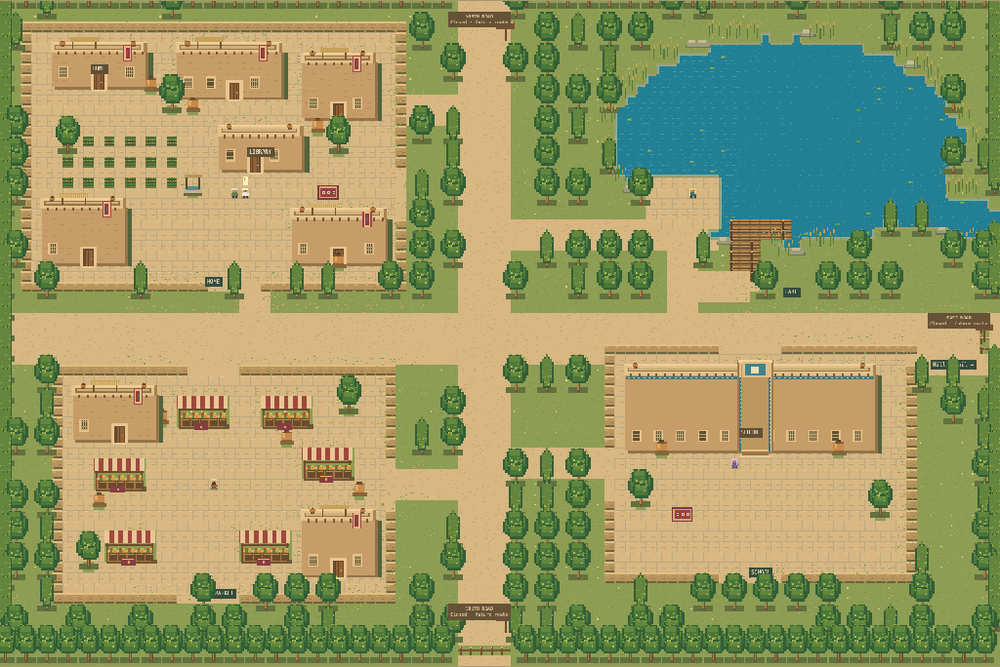

# Afghan village layout and rendering

The playable village is a 96×64 rectangular map on the existing 16-pixel movement grid. The supplied `public/assets/Afghan Village Hub Pixel Map.png` was visually inspected for its adobe compounds, irrigated greenery, lake, school, textile stalls and three barred roads. It is a reference, not a background or collision mask.

## Layout

- Northwest: walled residential compound, gardens, a well, shaded roof terraces, pottery and textiles. The existing Home doorway remains at (9,7); the existing Library entrance remains at (24,15).
- Northeast: irregular lake, shallow shoreline highlights, reeds, stones, floating plants and an accessible wooden dock. A narrower river leaves the eastern boundary above the reserved east road. Water is impassable.
- Southwest: open market aisles, striped woven awnings, baskets, crates and adobe buildings. Edris's ordinary placement is (20,46).
- Southeast: a school directly below the lake, with a formal central entrance, blue geometric trim and a walled teaching courtyard. Ms Hameed's ordinary placement is (70,44).
- Central packed-earth crossroads connect all districts. The separate Hills spur is at (94,34), below the east-road reservation. Existing chapter access still governs Hills.

The north, east and south roads terminate at visible barriers and signs. `reservedExits` records identity, boundary coordinate, direction and reachable approach; these are preparations, not active destinations. A physical map does not create a fifth teaching district or vocabulary quota.

## Authorities and layers

`content/RPG_WORLD.json` owns rectangular terrain rows, solid tile identities, optional collision rows, regions, buildings, scenery, transitions, chapter starts and conditional NPC placements. `world-data.ts` validates terrain/spawns/transitions and recovers invalid positions. `movement.ts` plans on the same walkability and actor occupancy used by the Phaser stepper; no second movement engine was added.

`village-art.ts` draws deterministic pixel art from that registry. Ground, paving, water, shoreline, walls and barriers bake directly into one 1536×1024 Phaser CanvasTexture, avoiding a temporary Graphics command buffer and a second rasterisation/copy. Building/prop textures are generated once per variant and reused on subsequent visits. Foreground sprites use their ground footpoint for depth ordering; buildings and market counters remain solid terrain. Textures belong to the Phaser game and are released on disposal. The covered village tilemap is hidden from drawing while retaining its collision data, avoiding a redundant terrain render behind the opaque baked ground. No atlas or reference-image download is needed in the offline release. House art and other interiors are reused. The subsequent [living-village expansion](LIVING_VILLAGE.md) adds portraits, distinct actor sprites and bounded routines; the release-specific measurements below predate it.

`phaser-world.ts` retains the terrain physics layer, optional collision overlay, actor bodies, camera follow, movement tween, pointer routing and map lifecycle. It selects village artwork only for maps with the new scenery definitions; historical test profiles retain their original rendering path.

Educational content, quotas, XP, grading, SRS and challenge activation stay in their existing JavaScript authorities. Registered RPG chapters remain Days 1–7. A pass enables educational completion/access; chapter advancement still requires explicit sleep, narrative acknowledgements, an eligible successor and no paused retry. Dreams remain disposable practice without persistent campaign learning or rewards.

## Existing saves

Education schema 7 and world schema 1, storage keys and revision coordination are unchanged. Existing walkable positions remain valid. A position made impassable by the redesign deterministically recovers to that map's configured safe spawn (or its existing row-major safe-tile fallback). The village collision overlay also excludes disconnected decorative margins and tiles beyond the future-road barriers, so recovery cannot strand a player in an isolated walkable pocket. This uses the established `world-data.recover` path; no old-format adapter, educational reset, XP recalculation or invented study is involved. House/Library/Hills coordinates are unchanged except the Hills return arrival in the village.

## Registering another map

1. Add a unique key under `maps`, with equal-width terrain rows of any rectangular dimensions, safe `spawn`, `transitions`, `regions` and `buildings`. Optional `collision` rows must match terrain dimensions. Use registered tile symbols; scenery must visually match solid geometry.
2. Add outgoing transitions `{x,y,to,spawn:{x,y}}` on reachable walkable tiles. Register the destination map and safe arrival first, and add its return transition. The existing transition type and controller work across different dimensions.
3. Add the map to the appropriate chapters' `maps` allowlists. Use existing chapter eligibility, event conditions and schedules for story restrictions; register object events and stable NPC identities with safe approaches.
4. To activate a reserved road, remove its barrier, replace its `reservedExits` entry with ordinary transition data and supply reviewed destination content. Do not increase curriculum quotas or chapter limits merely because a map exists.
5. Run registry/model reachability, collision, recovery and browser transition/route tests; inspect camera and footpoint overlap at desktop/mobile sizes. Rebuild with `python3 tools/build.py`. See [current architecture](RPG_ARCHITECTURE.md) and [validation policy](../../tests/README.md#choose-validation-by-change-and-risk).

The screenshots can be reproduced with `node tools/capture-village.mjs`. Rendering-only diagnostics use `node tools/village-render-performance.mjs --release index.html --output work/village-render.json`; pass a frozen baseline HTML to the same command for comparison. These tools use disposable test pages and do not add production debug controls.

## Running-game captures

These show the actual Phaser game, including a test-only camera overview of the complete map. The reference image is not used for these captures.

| District | Desktop | Mobile-sized camera |
|---|---|---|
| Residential | [View](village/residential-1280.png) | [View](village/residential-375.png) |
| Lake | [View](village/lake-1280.png) | [View](village/lake-375.png) |
| Market | [View](village/market-1280.png) | [View](village/market-375.png) |
| School | [View](village/school-1280.png) | [View](village/school-375.png) |

The procedural art interprets the reference at the established logical scale; it does not reproduce its dense illustrated shading or every textile motif. Mobile captures and checks use Chromium viewport/touch emulation, not physical iPhone Safari. Historical release reports and measurements remain evidence for their recorded builds.

## Verification and measured limits

Final strict typecheck and build consistency passed, along with nine world/chapter/movement/state model suites and all thirteen selected RPG browser suites. Both public routes completed Days 1–7, including real lessons/examinations, failure/retry, frozen reload, teacher relocations, Hills entry/return, sleep, graduation, dream selectors and reward locks. Fresh final-renderer captures and desktop/mobile dock/barrier/recovery checks passed. [Component output](village/validation.txt) records the actual checks.

The initial parallel `python3 tools/verify.py --rpg` attempt was interrupted after a headless animation-observation timeout and while adapting the duplicate long route to the larger map. [Its partial output](village/verification-attempt.txt) is retained; it is not a claimed passing full invocation. The animation check subsequently passed at both sizes and with the optional collision layer. Public long trips now use the real lock-respecting Quick travel controls, with physical approaches/interiors/Hills and independent all-placement grid coverage retained. The final component runs all passed.

The fourteen-day educational matrix and delivery-audit refresh were outside this map/art scope. Historical educational and performance reports retain their recorded hashes/results. A source comparison confirms unchanged narrative events, chapter rules, NPC identities/conditions and complete Home/Library interior definitions. Educational source and language data were untouched.

Release HTML: **4,609,414 → 4,639,566 bytes** (0.65% larger); gzip: **1,728,591 → 1,733,371 bytes** (0.28% larger). Final release SHA-256: `0d139a94c6ce372543f1728169188a90cad887c540c4f6c4ebbc0de3c7378dda`.

The rendering-only diagnostic was run sequentially after the route tests stopped. It uses three fresh world boots per profile and 120 animation-frame intervals; the world-start timer begins after document navigation, so it is not an end-to-end download/load metric. [Baseline data](village/render-baseline.json) and [final data](village/render-final.json) retain exact artifact fingerprints and texture dimensions.

| Profile | Median Enter-village → scene ready | Average animation-frame rate |
|---|---:|---:|
| 1280px / 1× CPU | 590 → 516 ms | 50.7 → 60.0 |
| 375px / 4× CPU | 1002 → 1314 ms | 57.6 → 55.0 |

The logical sum of registered texture dimensions × four RGBA bytes rises from **5.47 to 12.22 MiB**. This is an estimated pixel extent, not measured GPU/total-process memory. The larger map needs an additional cached 1536×1024 ground surface and reusable scenery textures. Phaser's active update-list count stayed stable across ten Library round trips in the lifecycle checks.

These small shared-host samples do not establish a universal speedup or regression. Startup/texture cost is a tradeoff of the larger map, and physical iPhone Safari, hardware audio/touch, GPU frame times and long-duration memory behavior remain manual checks. The fine painted shading and textile detail of the reference remain simplified at the existing tile scale.
