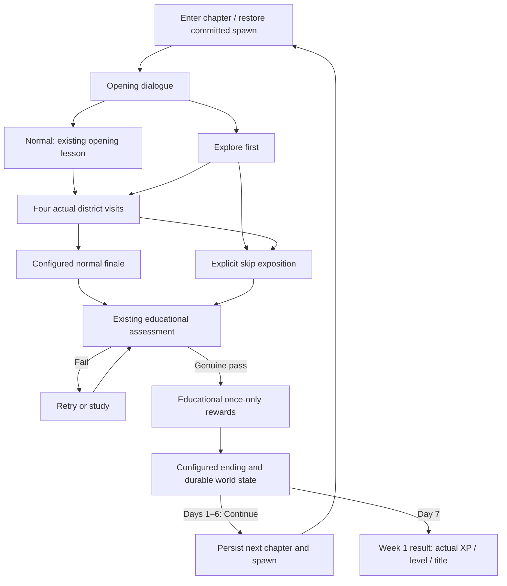

# Playable RPG Week 1

> Historical release evidence: original cast names, screenshots, counts and measurements below are retained. See [the subsequent character expansion](LIVING_VILLAGE.md) for Deena/Medina, the added villagers and its separate validation.

> Historical Week 1 implementation record. The [multiday overhaul](MULTIDAY_OVERHAUL.md) supersedes the terminal Day 7 policy, interface, movement, teacher placements and portrait handling described below.

Branch: `feature/rpg-week1`, based on reviewed foundation `04891a4a96e4bd8041361836ec57831958e832ba`. The default release now covers Days 1–7. Day 7 is terminal; the unchanged Days 8–14 educational curriculum remains available to regression tests, not the RPG player. Production main/Pages configuration is unchanged.

## Registry and routes

`content/RPG_WORLD.json` is the single validated build registry. Its `days` and consistently named `dayN-*` event sections separate chapters from generic TypeScript services. Each chapter declares stable ID, curriculum day, presentation, allowed maps/spawn, active placements, lessons, challenge host/map/location, opening, ending, normal/skip policy and next chapter. The historical Day 1 schema remains supported without the new optional fields; frozen Day 1 tests retain its terminal configuration.

| Day | Opening / initial spawn | Normal finale / challenge host | Special scene | Next |
|---|---|---|---|---|
| 1 | Muhammad Jan → Library tutorial | Home / Muhammad Jan | Home award through existing progression | 2 |
| 2 | Ms Hameed, School | Home / Muhammad Jan | School workshop, one actual School lesson | 3 |
| 3 | Saleha, Lake | Market / Edris | Buying produce for dinner | 4 |
| 4 | Muhammad Jan, Home | Home / Muhammad Jan | Informal I/you conversation | 5 |
| 5 | Ms Hameed, School | Lake / Saleha | Multi-character respectful-address gathering | 6 |
| 6 | Saleha introduces Mina, Lake | Hills / Saleha and Mina | Group conversation, Nature curriculum | 7 |
| 7 | Edris, Market | School / Ms Hameed | 25-question Week 1 examination and graduation | Terminal |

Normal play presents the opening; its lesson action calls the existing lesson ID exactly once when chosen. The other district lessons remain optional and revisitable. Eligibility remains educational authority: Day 2 requires School first and Business/Nature before Home; later days require their configured opening lesson before other normal visits. Once the four actual visits are complete, the host offers the configured normal finale. Its contextual conversation leads into the **existing daily assessment**, whose current curriculum already defines dinner shopping, informal speech, the Lake gathering and Hills/Week 1 scenes. There is no separate story answer evaluator or authored Pashto answer bank.

Early-challenge play is explicit. A challenge request before the normal finale opens that chapter's alternate exposition; choosing Start early challenge records that actual event and route. It does not mark the normal opening/finale or a lesson played. Assessment activation still licenses the frozen four-location vocabulary/forms/grammar without study grades, visit completion or extra lemmas. The existing genuine pass alone awards missing visits and once-only bonuses. Route selection remains stored after that catch-up, so the pass cannot retroactively pretend the normal route was played. Optional story scenes never block the early challenge.

## Maps, NPCs and event capabilities

The Village and Library remain. The Hills is a 32×24 traversable map with ridges, trees, paths, a western return gate, Saleha/Mina positions and a trail marker object. Enter from the east village path at `(49,18)`; return from Hills `(1,12)` to village `(48,18)`. It is allowed from Day 6 and belongs to the existing `nature` lesson identity, never a fifth allocation district. Day 6's opening return dialogue also offers a configured scene transition for accessibility; the walking route is tested separately.

Placements retain the stable `characterId` values `muhammad-jan`, `edris`, `saleha`, `hameed`, `mina`. Conditional Day 1 Jan placements remain intact. Ms Hameed starts Day 2/5 at School. On Day 5 Edris and Jan visit the Lake alongside Saleha, while their lesson actions retain the Business/Home curriculum IDs. Mina is absent before Day 6; she appears with Saleha at the Lake and in the Hills, with one persistent identity across those scene placements. On Day 7 she remains at the Lake. See each NPC's scheduled entries for exact coordinates/events; chapter spawns/host maps are checked for reachability.

The shared event engine handles sequential messages, per-message speaker/listener identity, response choices, conditions, persistent flags, once-only events, linked events, lesson/challenge actions, scene destinations, post-lesson return conversations, object interactions and map-entry events. Event status is derived as not started, in progress (saved cursor), or completed (durable trigger). Backing out does not complete an event. Choosing an eligible action completes that narrative event; educational activity still requires its own actual submissions. Unknown conditions fail closed. `allLessons`, `passed`, `notPassed`, named onboarding predicates and `event:`/`not-event:`/`flag:`/`not-flag:` conditions keep story-specific decisions out of Phaser.

## Advancement and persistence

The educational UI selects its next teaching day after a pass. The RPG now keeps its selected chapter separately until Continue; this fixes a reproduced bug where a Day 1 pass tried to resolve Day 2's skip event instead of Day 1's ending. No educational progression logic was changed.

Historical pre-sleep behavior (superseded by [house/sleep/dream](HOUSE_SLEEP_DREAM.md)): advancement checked a genuine recorded pass, the chosen route's actual narrative resolution and the completed ending. It disables repeat advancement, waits for successful educational/world persistence, writes the next chapter/spawn, then starts the existing scene and opening. Interrupted saves recover to the previous committed result (Continue can be retried) or the next committed spawn; no reward function runs during transfer. Confirmed openings/endings do not repeat after reload. Menu → Revisit completed chapters lets players return to eligible days and their lessons without resetting knowledge or rewards.

Educational schema 7, world schema 1, namespace isolation, Web Locks and the hash-only IndexedDB revision fence remain. Optional `routes` extends world state; frozen questions, submitted answers and scoring locks remain educational authority. Paired tutorial/lesson snapshots still restore before compaction. A valid active challenge determines the chapter shown on resume. Invalid/mismatched world drafts fall back safely while preserving validated educational progress. Unsupported/corrupt educational saves remain untouched until explicit reset. There is no obsolete-format migration and no atomic two-store guarantee: process termination can lose unacknowledged position/story/draft work. Lifecycle saves remain best effort.

## Adding Day 8 and future content

The inactive [Day 8 example](day8-registration.example.json) uses the existing Day 8 Nature opening, Saleha, demonstratives, four lesson IDs and assessment. It is not a build input. To enable a reviewed future chapter:

1. Add its chapter, opening/return/finale/skip/ending events, and NPC schedule overrides to the registry.
2. Link its existing curriculum day, four lessons and challenge; use educational eligibility/results rather than copying their rules.
3. Change the prior chapter to nonterminal, set `nextChapter` and raise `lastDay` only when the content and public route tests are ready.
4. Add any new map as tile/collision rows with spawn, transitions, region/object data. Declare it in chapter maps and test approach/return reachability. Ordinary maps need no Phaser engine change.
5. Reuse an existing character ID to relocate someone. For a new person, add one stable identity, a supported sprite, schedules and events; never duplicate educational ownership.
6. Use `messages` with speaker/listener fields for group conversations, conditional action entries for alternate choices and `resumeEvent` for post-lesson dialogue. Optional side conversations are ordinary events with flags; no side-quest reward system exists.
7. Run registry/model, normal and early public routes, interruption/reload, reward-idempotency, mobile/layout and full fourteen-day regression checks before release.

No movement, collision, rendering, XP, sentence or assessment rewrite is required for an ordinary new teaching day. New art/linguistic features require their own actual assets/review, not assumptions about current support.

## Verification, performance and limits

Actual final results and exact-release benchmarks are recorded in [validation](RPG_VALIDATION.md). The historical [foundation validation](FOUNDATION_VALIDATION.md) and [foundation audit](FOUNDATION_AUDIT.md) describe their original release, not this expansion.

Physical iPhone Safari, WebKit/device lifecycle/storage eviction and speech quality remain unverified. Chromium touch/DPR/viewport tests are not physical-device certification. Pashto base/phrase approvals retain their recorded scope; generated combinations/inflections and voices are not native-certified, no new Pashto phrase approval was invented, and no MP3 recording pack was added. Stationary schedules and simple procedural art remain deliberate limits; this is not an autonomous NPC simulation or cutscene engine.
